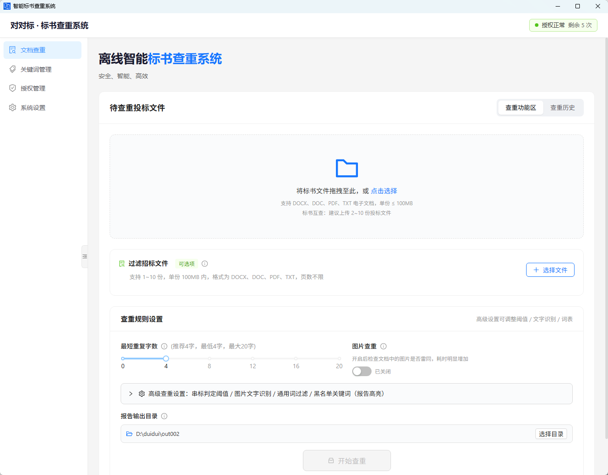
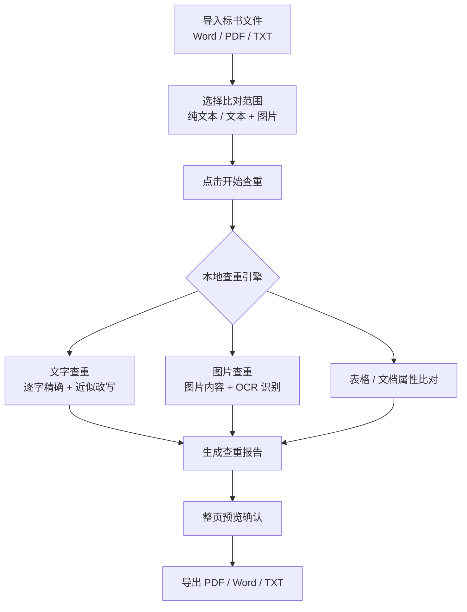
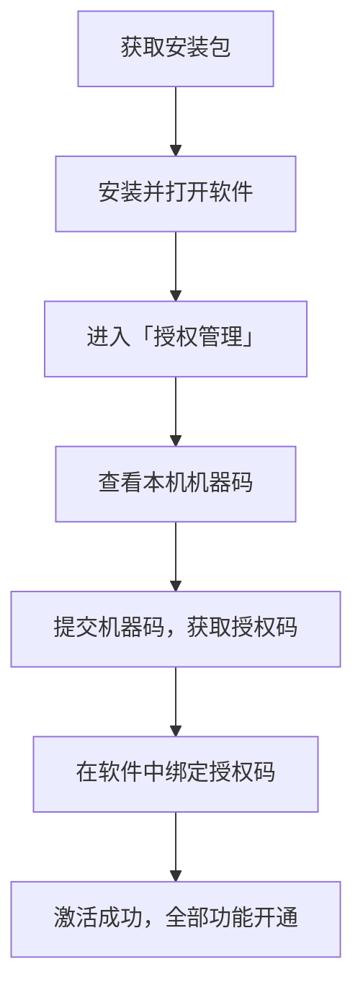

# 对对标 · 智能标书查重系统

> 导入标书 · 一键查重 · 报告可导出
>
> 全程本地离线运行，文件不上传，数据不出本机。

---

## 免费赠送 9 个兑换码（限时发放）

> **欢迎使用「对对标」标书查重系统！**
>
> 现 **免费赠送 9 个兑换码**，先到先得，领完即止。

| 序号 | 兑换码 |
| :---: | :---: |
| 1 | **7FWW-M2TE** |
| 2 | **H8NE-6A30** |
| 3 | **54MR-5JKE** |
| 4 | **GR5X-8ANV** |
| 5 | **TXX2-C8CS** |
| 6 | **57MH-6BX3** |
| 7 | **K7BN-CCNR** |
| 8 | **K8PN-A4WY** |
| 9 | **CX64-FY8F** |

**兑换与安装步骤**

1. 在电脑浏览器访问：`https://duidui.chachaai.com/redeem`
2. 输入上方任意一个兑换码，按页面说明操作
3. 下载并安装软件
4. 绑定授权，即可开始使用

> 您的兑换码示例：**【7FWW-M2TE】**
>
> 提示：一个兑换码仅能绑定一台设备，绑定后不可更换机器，请确认好长期使用的那台电脑。

***

## 一、产品简介

「对对标」是一款**桌面端标书查重软件**。安装在本机后，导入 Word / PDF / TXT 等投标文件即可进行比对查重，自动定位重复文字、重复图片、重复段落，并生成可导出、可汇报的查重报告。

> 主界面：导入待查重投标文件、过滤招标文件、设置查重规则，一键开始查重。

适用场景包括：

- 投标前对自家标书做雷同自查
- 多家投标文件交叉比对，快速发现异常相似
- 技术方案、资质材料、图表附件的重复排查
- 历史标书复盘与素材复用检查

***

## 二、核心功能

### 2.1 查重能力

- **多文档同时比对**：支持多份文件交叉比对，一次导入、统一出结果
- **逐字精确查重**：大段照抄的内容可以被定位到具体位置
- **近似改写识别**：换词、改句、调整顺序的近似内容也能识别
- **相似度矩阵**：多份文件两两相似度一表看清
- **异常雷同预警**：多份文件出现高度相似时给出提示
- **表格查重**：表格内容单独比对，不只查正文
- **图片查重**：图片内容与图片属性双重比对
- **图片文字 OCR**：扫描件、图片中的文字可识别后参与比对
- **文档属性比对**：作者、创建时间、生成程序等元信息也可比对
- **分阶段进度展示**：查重过程实时可见

### 2.2 高亮与过滤

- **招标文件过滤**：导入招标方原文后，招标原文不计入重复，避免固有条款被误标
- **通用词过滤**：去掉行业套话带来的干扰
- **关键词组管理**：常用词一键复用
- **重点词高亮**：敏感位置直接标出

### 2.3 报告与展示

- **总览报告**：重复率、重复字数等统计一目了然
- **原文对比报告**：左右分栏对照，重复内容标红
- **文档对比报告**：逐份列出重复内容
- **整页预览**：导出前可先检查报告效果
- **结果统计看板**：数据集中呈现
- **查重历史管理**：往次结果可回溯
- **多格式导出**：支持 PDF / Word / TXT

***

## 三、使用流程

三步完成一次查重，会用电脑就会用，不需要专门培训。

### 操作三步

1. **导入文件**：拖拽或点击导入需要比对的文件（2 份及以上）
2. **开始查重**：勾选文件，点击「开始查重」，进度实时显示
3. **查看报告**：查看统计与标红结果，一键导出 PDF / Word / TXT

***

## 四、为什么选择本地离线版

| 对比项    | 在线查重网站 | 本软件（本地离线）       |
| ------ | ------ | --------------- |
| 文件是否上传 | 需要上传   | **不上传**         |
| 数据留存   | 存在留存顾虑 | **只在本机**        |
| 是否联网   | 需要联网   | **激活后断网可用**     |
| 敏感项目   | 适用性有限  | **可放心使用**       |
| 计费方式   | 多为按年订阅 | **可按次购买，次数不过期** |

> 本软件为本地部署工具，文件解析、查重比对、报告生成全部在本机完成，不经过任何服务器，也没有云端存储环节。

***

## 五、安装与激活

### 安装激活四步

1. **获取安装包**：获取 Windows 安装程序，双击安装
2. **查看机器码**：打开软件 → 左侧「授权管理」→ 复制「本机机器码」
3. **获取授权码**：凭机器码完成授权码获取
4. **绑定激活**：软件「授权管理」→「绑定授权码」→ 粘贴授权码 → 点击「激活」

> **提示**：授权码与设备绑定，激活后不可更换机器。请在激活前确认好长期使用的那台电脑。

***

## 六、套餐与计费方式

软件提供三种计费方式，可按实际使用频率选择：

- **按次套餐**：购买的是查重次数，**次数不过期**，用完为止，支持叠加购买
- **时长套餐**：激活当天起算，**有效期内不限次数**
- **长期授权**：一次购买，**长期使用**，无需续费

常见选择参考：

| 使用情况       | 建议方案              |
| ---------- | ----------------- |
| 想先试试效果     | 少量次数的体验套餐或短期时长套餐  |
| 一年投几次标     | 常用次数套餐            |
| 一个月要用很多次   | 30 天 / 90 天时长套餐   |
| 团队长期做标     | 180 天 / 365 天时长套餐 |
| 招标代理、常年大批量 | 大批量次数套餐或长期授权      |

> 具体套餐规格与权益，以购买时选择的规格为准。

***

## 七、运行环境

| 项目   | 要求                       |
| ---- | ------------------------ |
| 操作系统 | 推荐 Windows 10 / 11（64 位） |
| 内存   | 建议 4GB 及以上               |
| 磁盘空间 | 建议预留 2GB 以上可用空间          |
| 网络   | 激活后无需联网，可完全离线使用          |
| 支持格式 | Word（doc / docx）、PDF、TXT |

***

## 八、常见问题

**Q：必须联网才能用吗？**
A：不用。绑定授权码激活后，软件完全离线运行，查重全程不联网。

**Q：我的标书会被上传吗？**
A：不会。文件解析、查重、报告生成全部在本机完成，不经过任何服务器。

**Q：能查扫描件和图片里的字吗？**
A：可以。软件内置离线 OCR，能识别图片中的文字并参与查重比对。

**Q：能查表格吗？**
A：可以，表格内容会单独进行比对。

**Q：按次套餐会过期吗？**
A：不会。次数用完为止，未使用的次数一直有效。

**Q：时长套餐到期后呢？**
A：到期后软件会锁定，续费或购买新套餐即可继续使用。

**Q：换电脑能用吗？**
A：授权码与设备一对一绑定，绑定后无法更换机器。请先确认好长期使用的电脑；如遇电脑损坏、换机等特殊情况，可先联系购买渠道说明情况。

**Q：支持哪些文件格式？**
A：Word（doc / docx）、PDF、TXT。

***

## 九、售后与服务

- **发货时效**：付款后尽快发出安装包与授权码，工作时间通常较快响应
- **安装指导**：提供图文安装教程
- **使用答疑**：软件操作问题可随时咨询购买渠道
- **授权保障**：如因系统原因导致无法激活，提供补发或退款处理
- **发票**：支持开具发票，可联系购买渠道提供开票信息

***

## 十、购买须知

1. 本商品为**虚拟软件商品**，一经发货并激活，**不支持退款**（因系统原因无法激活的除外）。
2. 本商品为**电子发货**，**不邮寄实物**，请确保可正常接收安装包与授权码。
3. 授权码与机器码绑定，**绑定后无法更换机器**，请在激活前确认使用设备。
4. 查重结果由软件算法比对得出，**仅供内部自查参考**，不构成对投标结果、中标与否的任何承诺或保证。
5. 软件仅供合法用途使用；禁止破解、反编译、二次销售授权码，违规将终止授权且不退款。
6. 实际价格与权益以购买时选择的规格为准。

***

## 免责声明

本文档仅用于产品功能介绍与使用说明。软件查重结果为算法比对结果，仅供内部自查参考，不构成任何形式的投标结果承诺。文中不包含任何下载地址、联系方式或账户信息，请通过正规购买渠道获取正版软件与授权。
